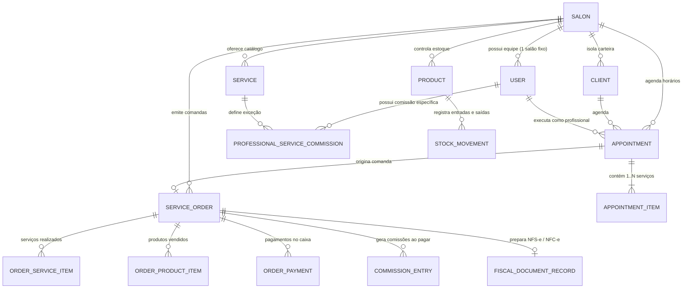

# PRD — Arquitetura, Modelagem de Dados, Segurança e IA — SPS

## 1. Stack Confirmada e Convenções Técnicas

- **Linguagem e Framework:** Python `3.13.6` + Django `5.2 LTS` (configuração única em `core/settings.py` usando `django-environ` com suporte a arquivos de Docker Secrets via `FileAwareEnv`).
- **Persistência e Cache/Filas:** PostgreSQL `16+` (banco relacional), RabbitMQ `3.13+` (broker Celery), Redis `7+` (cache e result backend do Celery), Celery Worker, Celery Beat e `dj-celery-panel`.
- **Relatórios, Docs e IA:** `ReportLab` + `PyPDF` (relatórios privados em PDF), `MkDocs` + `mkdocs-material` / `pymdownx.superfences` (suporte a `Mermaid`), `LangChain` + `LangGraph` (Assistente Gerencial Interno com `modelo_llm` parametrizado via `.env`).
- **Convenções de Código:** Código em inglês, PEP 8, aspas simples (`'`), interface e mensagens 100% em `pt-BR`, fuso `America/Sao_Paulo`, preferência por Class-Based Views (CBVs) nativas, signals restritos a `signals.py` de cada app e modelos herdando de `base.models.TimeStampedModel` (`created_at`, `updated_at`) e `TenantScopedModel` (`salon`).

---

## 2. Organização de Pacotes e Apps Django na Raiz (`sps/`)

| Pacote / App | Tipo | Responsabilidade Coesa no Domínio |
|---|---|---|
| `core` | Config | `settings.py`, `urls.py`, `wsgi.py`, `asgi.py`, `celery.py` (não listado como app de domínio). |
| `base` | App Base | `TimeStampedModel`, `TenantScopedModel`, `TenantManager`, mixins CBV de isolamento/permissão, healthchecks (`/healthz/`, `/readyz/`) e comando `wait_for_db`. |
| `accounts` | Domínio | `User` customizado (`AUTH_USER_MODEL` com login por e-mail), papéis (`superadmin_saas`, `gestor`, `recepcionista`, `profissional`) e vínculo fixo `salon` (`DEC-002`). |
| `salons` | Domínio | Entidade `Salon` (tenant), horários de funcionamento (`SalonBusinessHours`), feriados (`SalonHoliday`), configurações operacionais e dados fiscais do emitente (`RF-001`). |
| `catalog` | Domínio | Categorias (`ServiceCategory`), serviços (`Service`), habilitação de profissionais e tabela de comissão específica por profissional (`ProfessionalServiceCommission` — `RF-003`). |
| `clients` | Domínio | Cadastro de clientes isolado por salão (`Client`), dados de tomador fiscal (CPF/CNPJ, endereço) e consulta unificada de histórico (`RF-004`). |
| `scheduling` | Domínio | Expediente individual (`ProfessionalSchedule`), bloqueios de agenda (`ScheduleBlock`), agendamentos (`Appointment`) com múltiplos itens (`AppointmentItem`), motor de disponibilidade e visão pública `/s/<slug>/` (`RF-005`, `RF-006`). |
| `orders` | Domínio | Comandas de atendimento (`ServiceOrder`), itens de serviço executado (`OrderServiceItem`) e itens de produto vendido (`OrderProductItem` — `RF-007`). |
| `inventory` | Domínio | Produtos (`Product`) com metadados fiscais (NCM, CEST, CFOP), controle de saldo, alerta de estoque mínimo e livro razão de movimentações (`StockMovement` — `RF-008`). |
| `finance` | Domínio | Sessão de caixa diário (`CashRegisterSession`), movimentações financeiras (`CashTransaction`), pagamentos (`OrderPayment`) e comissões geradas no pagamento (`CommissionEntry` — `RF-009`). |
| `fiscal` | Domínio | Registro preparatório de documento fiscal (`FiscalDocumentRecord`), itens fiscais snapshot e interface desacoplada `FiscalGatewayAdapter` com implementação *stub* (`RF-013`, `DEC-003`). |
| `notifications` | Domínio | Disparo assíncrono de e-mails transacionais e lembretes periódicos via Celery com registro de idempotência (`NotificationLog` — `RF-010`). |
| `reports` | Domínio | Dashboard gerencial, geradores de PDF com `ReportLab`/`PyPDF` e comando `seed_demo_data` (`RF-011`, `RNF-006`). |
| `ai_assistant` | Domínio | Grafo conversacional `LangGraph`, histórico de sessão de chat e *tools* somente-leitura escopadas estritamente pelo `salon_id` da sessão (`RF-012`). |

---

## 3. Modelagem Conceitual e Diagrama Entidade-Relacionamento



### Especificação das Entidades Principais e Campos Fiscais (`DEC-003`)

1. **`Salon` (`salons.Salon`):**
   - Identificação: `name`, `trade_name`, `slug` (único), `phone`, `email`, `is_active`, `timezone` (`America/Sao_Paulo`), `cancellation_min_hours` (inteiro, padrão `2`).
   - Dados Fiscais Preparatórios (`RF-001`, `DEC-003`): `cnpj`, `municipal_registration` (IM), `state_registration` (IE), `tax_regime` (`mei`, `simples_nacional`, `lucro_presumido`, `lucro_real`), `ibge_city_code`, `address_street`, `address_number`, `address_neighborhood`, `address_zip_code`, `is_partner_salon_regime` (boolean indicando adoção da Lei do Salão-Parceiro).
2. **`User` (`accounts.User`):**
   - `email` (`USERNAME_FIELD`, único), `full_name`, `phone`, `role` (`superadmin_saas`, `gestor`, `recepcionista`, `profissional`), `salon` (`ForeignKey` nula apenas para `superadmin_saas`), `tax_document` (CPF/CNPJ opcional para profissional-parceiro no rateio fiscal), `is_active`.
3. **`Service` e `ProfessionalServiceCommission` (`catalog`):**
   - `Service`: `salon`, `category`, `name`, `duration_minutes` (`> 0`), `base_price` (`Decimal(10,2)`), `default_commission_pct` (`Decimal(5,2)`, `0..100`), `professionals` (`M2M` com `User`), `is_active`. Campos fiscais: `lc116_service_code`, `cnae_code`, `iss_rate_pct` (opcionais).
   - `ProfessionalServiceCommission`: `salon`, `professional`, `service`, `commission_pct` (`Decimal(5,2)`). Restrição: `UniqueConstraint(fields=['salon', 'professional', 'service'])`.
4. **`Client` (`clients.Client`):**
   - `salon`, `full_name`, `phone`, `email`, `birth_date`, `notes`. Campos fiscais opcionais (`RF-004`): `cpf_cnpj`, `address_street`, `address_number`, `address_complement`, `address_neighborhood`, `address_city`, `address_state`, `address_zip_code`, `ibge_city_code`. Restrição: unicidade de `(salon, phone)` e `(salon, cpf_cnpj)` quando informado.
5. **`Appointment` e `AppointmentItem` (`scheduling`):**
   - `Appointment`: `salon`, `client`, `professional`, `start_at`, `end_at` (calculado pela soma de `duration_minutes` dos itens), `total_estimated_amount`, `status` (`agendado`, `confirmado`, `em_atendimento`, `concluido`, `cancelado`, `nao_compareceu`), `public_token` (`UUID` único para consulta/cancelamento público), `cancellation_reason`, `cancelled_at`.
   - `AppointmentItem`: `appointment`, `service`, `duration_minutes_snapshot`, `price_snapshot`.
6. **`ServiceOrder`, `OrderServiceItem` e `OrderProductItem` (`orders`):**
   - `ServiceOrder`: `salon`, `appointment` (`OneToOne` opcional), `client`, `status` (`aberta`, `fechada_paga`, `cancelada`), `subtotal_services`, `subtotal_products`, `discount_amount`, `surcharge_amount`, `total_amount`, `closed_at`, `closed_by`.
   - `OrderServiceItem`: `order`, `service`, `professional`, `gross_price`, `discount_amount`, `net_price`, `applied_commission_pct` (preenchido no fechamento).
   - `OrderProductItem`: `order`, `product`, `quantity` (`> 0`), `unit_price`, `total_price`.
7. **`Product` e `StockMovement` (`inventory`):**
   - `Product`: `salon`, `name`, `sku`, `usage_type` (`venda`, `consumo_interno`, `ambos`), `cost_price`, `sale_price`, `current_stock` (inteiro `>= 0`), `min_stock_alert`, `is_active`. Campos fiscais (`RF-008`): `ncm_code`, `cest_code`, `cfop_default`, `tax_origin`, `icms_rate_pct`, `pis_cofins_regime` (opcionais).
   - `StockMovement`: `salon`, `product`, `movement_type` (`entrada_compra`, `saida_venda_comanda`, `saida_consumo_interno`, `ajuste_inventario`, `estorno_comanda`), `quantity_delta`, `balance_after`, `order` (opcional), `actor`, `reason`.
8. **`CashRegisterSession`, `CashTransaction`, `OrderPayment` e `CommissionEntry` (`finance`):**
   - `CashRegisterSession`: `salon`, `opened_by`, `opened_at`, `opening_balance`, `closed_by`, `closed_at`, `closing_balance_expected`, `closing_balance_counted`, `status` (`aberto`, `fechado`).
   - `OrderPayment`: `order`, `cash_session`, `payment_method` (`dinheiro`, `pix`, `cartao_credito`, `cartao_debito`), `amount`.
   - `CommissionEntry`: `salon`, `order`, `order_service_item`, `professional`, `base_amount`, `commission_pct`, `commission_amount`, `status` (`pendente_repasse`, `pago_ao_profissional`, `estornado`), `paid_at`.
9. **`FiscalDocumentRecord` (`fiscal.FiscalDocumentRecord` — `RF-013`, `DEC-003`):**
   - `salon`, `order` (`OneToOne`), `document_scope` (`nfse_servico`, `nfce_produto`, `misto`), `status` (`nao_solicitada`, `pendente_integracao_futura`, `pronta_para_envio`, `emitida`, `erro_emissao`, `cancelada`), `issuer_snapshot` (`JSONField` com CNPJ/IM/IE/regime do salão), `customer_snapshot` (`JSONField` com CPF/CNPJ e endereço do cliente), `services_fiscal_payload` (`JSONField` com itens LC116, valores e rateio Salão-Parceiro se aplicável), `products_fiscal_payload` (`JSONField` com itens NCM/CFOP e valores), `external_provider_name`, `external_reference_id`, `fiscal_number`, `fiscal_series`, `access_key`, `xml_url`, `pdf_danfe_url`, `last_error_message`.

---

## 4. Invariantes de Domínio, Transações e Concorrência

1. **Invariante de Não-Colisão de Agenda (`RF-005`, `RF-006`, `RNF-002`):**
   - Na criação ou remarcação de agendamento, o serviço `SchedulingService.create_or_reschedule()` abre `transaction.atomic()`, executa `User.objects.select_for_update().get(pk=professional.pk, salon=salon)` para serializar tentativas simultâneas no mesmo profissional e verifica que não existe `Appointment` no mesmo `salon` e `professional` com `status__in=['agendado', 'confirmado', 'em_atendimento']` onde `start_at < novo_end_at` e `end_at > novo_start_at`, nem `ScheduleBlock` sobreposto.
2. **Invariante de Fechamento Atômico de Comanda, Estoque, Caixa, Comissão e Registro Fiscal (`RF-007` a `RF-009`, `RF-013`):**
   - O serviço `OrderCheckoutService.close_and_pay_order()` executa em uma única `transaction.atomic()`:
     1. Bloqueia a `ServiceOrder` e os `Product` envolvidos com `select_for_update()`.
     2. Verifica que o caixa diário (`CashRegisterSession`) do salão está `aberto`.
     3. Verifica que a soma de `OrderPayment` equivale ao `total_amount` da comanda.
     4. Para cada `OrderProductItem`, valida `product.current_stock >= item.quantity`; se insuficiente, lança `InsufficientStockError` abortando toda a transação; caso contrário, decrementa `current_stock` e grava `StockMovement(saida_venda_comanda)`.
     5. Para cada `OrderServiceItem`, consulta `ProfessionalServiceCommission` para `(salon, professional, service)`; se existir, usa `commission_pct` específico; senão, usa `service.default_commission_pct`. Calcula o valor com arredondamento `ROUND_HALF_UP` (2 casas decimais) e grava `CommissionEntry(status='pendente_repasse')`.
     6. Registra a entrada financeira em `CashTransaction`, altera a comanda para `fechada_paga` e gera/atualiza o `FiscalDocumentRecord` (`status='pendente_integracao_futura'`) através do contrato `FiscalGatewayAdapter.prepare_from_order(order)`.

---

## 5. Isolamento Multi-tenant, Permissões, Filas e Agente de IA

- **Isolamento em Todos os Caminhos (`RNF-001`):**
  - Toda CBV interna herda de `SalonTenantRequiredMixin`, que injeta `request.salon = request.user.salon` e filtra automaticamente `get_queryset()` por `salon=request.salon`.
  - Formulários (ModelForms) filtram todos os campos `ForeignKey` e `ManyToManyField` (`client`, `professional`, `service`, `product`) pelo `request.salon`, impedindo associação cruzada via adulteração de POST (`Cenário D` do guia de segurança).
  - Relatórios em PDF (`reports`) não são salvos em diretório público estático; são gerados sob demanda ou servidos via view autenticada que verifica `obj.salon_id == request.user.salon_id` e o perfil exigido.
- **Tarefas Assíncronas Idempotentes (`RF-010`):**
  - As tasks Celery recebem `salon_id` e `appointment_id` primitivos, revalidam no banco que o salão e o agendamento continuam ativos e consultam/gravam `NotificationLog` com `UniqueConstraint(fields=['appointment', 'notification_type', 'reference_window'])` antes de disparar `send_mail()`.
- **Assistente Gerencial Interno com Contexto Autorizado (`RF-012`):**
  - O grafo `LangGraph` constrói as *tools* (`get_salon_agenda_summary`, `get_revenue_and_commissions_summary`, `get_low_stock_products`, `get_inactive_clients`) usando fechamento (*closure* / `RunnableConfig`) com `salon_id = request.user.salon_id` e `user_role = request.user.role` fixados no servidor. O modelo LLM não possui parâmetro para alterar `salon_id`.

### 5.1 Cenários Obrigatórios de Verificação de Segurança Multi-tenant (`DEC-001`)

| Código | Cenário de Verificação | Resultado Esperado |
|---|---|---|
| `SEC-A` | Usuário autorizado (`gestor`/`recepcionista`) acessa registro do próprio salão. | Operação permitida (`200 OK` / `302 Redirect`). |
| `SEC-B` | Usuário autenticado no Salão A tenta acessar URL de detalhe/edição de ID pertencente ao Salão B. | Negação imediata (`404 Not Found` ou `403 Forbidden`), sem vazar existência do registro. |
| `SEC-C` | `profissional` ou `recepcionista` tenta acessar rota exclusiva de `gestor` no mesmo salão (ex.: estorno ou configurações fiscais). | Negação imediata (`403 Forbidden`). |
| `SEC-D` | Submissão POST tenta associar `client_id`, `professional_id`, `service_id` ou `product_id` pertencente a outro salão. | Rejeição na validação do form/serviço (`ValidationError`), sem persistir vínculo cruzado. |
| `SEC-E` | Tentativa de download de relatório PDF (`reports`) sem sessão válida ou de outro salão/profissional. | Negação imediata (`403 Forbidden` / redirect para login). |
| `SEC-F` | Task Celery agendada executa após desativação do salão ou cancelamento do agendamento. | Worker revalida estado no banco e aborta envio de forma limpa e registrada. |
| `SEC-G` | Prompt no Assistente de IA solicita dados financeiros ou de clientes de outro `salon_id`. | Tools consultam exclusivamente `salon_id = request.user.salon_id`; nenhum dado externo é retornado. |

### 5.2 Contrato Desacoplado de Preparação Fiscal (`FiscalGatewayAdapter` — `DEC-003`)

```python
class FiscalGatewayAdapter:
    """Contrato base para preparação e futura emissão de NFS-e (serviços) e NFC-e (produtos)."""

    def prepare_from_order(self, order) -> 'FiscalDocumentRecord':
        """Consolida snapshots fiscais de emitente (Salon), tomador (Client), serviços e produtos."""
        raise NotImplementedError

    def request_issuance(self, fiscal_record) -> dict:
        """No MVP (StubFiscalGatewayAdapter), mantém status 'pendente_integracao_futura' sem chamada externa."""
        raise NotImplementedError
```

---

## 6. Design System e Experiência de Interface (`08_design_system`)

- O desenvolvedor fornecerá a pasta `sps/design_system/` antes da sprint de interface (`Sprint 05`/`Sprint 08`).
- Quando fornecida, será extraído o catálogo de tokens (cores, tipografia, espaçamentos, estados de carregamento/vazio/erro e componentes de tabela/agenda/comanda) sem inventar bibliotecas visuais não aprovadas.
