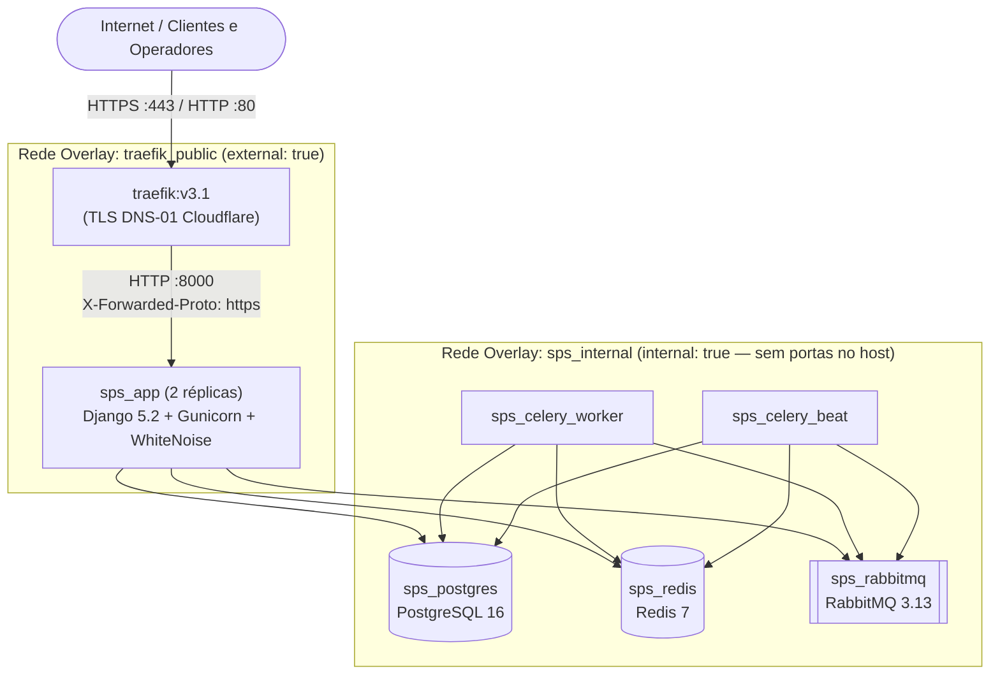

# Runbook de Implantação, Operação e Continuidade (Docker Swarm) — SPS

## 1. Finalidade e Governança Operacional

Este runbook documenta o procedimento completo de implantação, atualização, monitoramento, backup e restauração do **SPS (Sistema Para Salões)** em uma **VPS Ubuntu (`22.04 LTS` ou `24.04 LTS`)** orquestrada com **Docker Swarm**, **Traefik (`v3.1`)**, **Cloudflare DNS-01** e **Docker Secrets** (`RNF-004`, `RNF-005`).

- **Execução Exclusiva pelo Desenvolvedor:** A IA nunca executa comandos de deploy remoto, publicação em registry nem operações de Git/GitHub.
- **Zero Git/GitHub em Scripts (`scripts/deploy.sh`):** Os scripts operacionais em [`sps/scripts/`](../../scripts/deploy.sh) operam exclusivamente sobre imagens Docker e volumes do Swarm.
- **Variáveis `a_definir` a substituir antes do primeiro deploy:**
  - `{{dominio_principal}}`: domínio público de produção (ex.: `sps.seudominio.com.br`).
  - `{{registry_imagem}}`: endereço do repositório da imagem (ex.: `ghcr.io/seu_usuario/sps`).
  - `{{endereco_swarm}}`: IP da interface principal da VPS para `docker swarm init`.
  - `{{tag_release}}`: versão imutável da imagem (ex.: `1.0.0`).

---

## 2. Topologia de Redes Overlay e Containers no Swarm



---

## 3. Checklist Pré-Implantação na VPS Ubuntu

### 3.1 Provisionamento Inicial e Firewall (`UFW`)
```bash
sudo apt-get update && sudo apt-get upgrade -y
sudo apt-get install -y ca-certificates curl gnupg ufw
sudo ufw default deny incoming
sudo ufw default allow outgoing
sudo ufw allow OpenSSH
sudo ufw allow 80/tcp
sudo ufw allow 443/tcp
sudo ufw --force enable
```

### 3.2 Inicialização do Swarm e Rede Externa
```bash
docker swarm init --advertise-addr {{endereco_swarm}}
docker network create --driver overlay traefik_public
sudo mkdir -p /opt/sps /var/backups/sps
sudo chmod 700 /opt/sps /var/backups/sps
```

### 3.3 Criação dos 5 Docker Secrets Obrigatórios (`RNF-005`)
Execute no terminal seguro do nó manager (nunca versione estes valores):
```bash
printf '%s' 'SEU_TOKEN_CLOUDFLARE_DNS' | docker secret create CLOUDFLARE_DNS_API_TOKEN -
printf '%s' 'SUA_DJANGO_SECRET_KEY'    | docker secret create SPS_DJANGO_SECRET_KEY -
printf '%s' 'SENHA_FORTE_POSTGRES'     | docker secret create SPS_POSTGRES_PASSWORD -
printf '%s' 'SENHA_FORTE_RABBITMQ'     | docker secret create SPS_RABBITMQ_PASSWORD -
printf '%s' 'SUA_CHAVE_API_LLM'        | docker secret create SPS_LLM_API_KEY -
docker secret ls
```

### 3.4 Arquivo `/opt/sps/.env.prod` (`chmod 600`)
```ini
DEBUG=False
USE_SQLITE_FALLBACK=False
TIME_ZONE=America/Sao_Paulo
LANGUAGE_CODE=pt-br
ALLOWED_HOSTS={{dominio_principal}},.{{dominio_principal}},localhost,127.0.0.1
CSRF_TRUSTED_ORIGINS=https://{{dominio_principal}},https://*.{{dominio_principal}}

SECRET_KEY_FILE=/run/secrets/SPS_DJANGO_SECRET_KEY
POSTGRES_DB=sps_prod
POSTGRES_USER=sps_user
POSTGRES_PASSWORD_FILE=/run/secrets/SPS_POSTGRES_PASSWORD
POSTGRES_HOST=postgres
POSTGRES_PORT=5432

RABBITMQ_DEFAULT_USER=sps_mq
RABBITMQ_DEFAULT_PASS_FILE=/run/secrets/SPS_RABBITMQ_PASSWORD
CELERY_RESULT_BACKEND=redis://redis:6379/1
REDIS_CACHE_URL=redis://redis:6379/0

LLM_MODEL=a_definir
LLM_API_KEY_FILE=/run/secrets/SPS_LLM_API_KEY
```

---

## 4. Procedimento de Build e Deploy Serializado (`scripts/deploy.sh`)

### 4.1 Build e Push da Imagem pelo Desenvolvedor
Na máquina de build (onde o código revisado está disponível):
```bash
cd sps
docker build -t {{registry_imagem}}:{{tag_release}} .
docker push {{registry_imagem}}:{{tag_release}}
```

### 4.2 Execução do Deploy na VPS
Copie [`docker-stack.yml`](../../docker-stack.yml) e [`scripts/`](../../scripts/deploy.sh) para `/opt/sps/`, substitua os placeholders `{{dominio_principal}}`, `{{registry_imagem}}` e `{{tag_release}}` e execute:
```bash
cd /opt/sps
chmod +x scripts/deploy.sh scripts/backup_sps.sh scripts/restore_sps.sh
IMAGE_REPO={{registry_imagem}} IMAGE_TAG={{tag_release}} ./scripts/deploy.sh
```

O script [`scripts/deploy.sh`](../../scripts/deploy.sh) realiza em sequência:
1. Verifica que o Swarm está `active` e que `traefik_public` existe.
2. Verifica a existência dos 5 Docker Secrets.
3. Executa `docker pull` da imagem alvo.
4. Aplica `docker stack deploy --with-registry-auth -c docker-stack.yml sps`.
5. Executa `python manage.py wait_for_db && python manage.py migrate --noinput` de forma **serializada em container único** na rede `sps_sps_internal` antes de atualizar as réplicas.
6. Atualiza `sps_app`, `sps_celery_worker` e `sps_celery_beat` com `start-first`.

### 4.3 Verificação Pós-Deploy (Smoke Check e TLS)
```bash
docker stack ps sps
curl -fsSL https://{{dominio_principal}}/healthz/
curl -fsSL https://{{dominio_principal}}/readyz/
openssl s_client -connect {{dominio_principal}}:443 -servername {{dominio_principal}} </dev/null 2>/dev/null | openssl x509 -noout -dates -subject
```

---

## 5. Rotina de Backup Diário e Restauração (`RNF-004`: `RPO <= 24h`, `RTO <= 2h`)

### 5.1 Agendamento do Backup Diário (`cron`)
O script [`scripts/backup_sps.sh`](../../scripts/backup_sps.sh) gera um dump lógico comprimido (`pg_dump -Fc`) do PostgreSQL e um arquivo `.tar.gz` do volume `sps_media_data`, mantendo retenção de 14 dias em `/var/backups/sps`:
```bash
# Adicionar ao crontab do root (crontab -e) para executar diariamente às 03:15 BRT:
15 3 * * * /opt/sps/scripts/backup_sps.sh >> /var/log/sps_backup.log 2>&1
```

### 5.2 Procedimento de Restauração e Ensaio de Continuidade (`RTO <= 2h`)
Para restaurar um ponto de recuperação usando [`scripts/restore_sps.sh`](../../scripts/restore_sps.sh):
```bash
# 1. Escalar temporariamente app e workers para 0 durante a restauração do banco
docker service scale sps_app=0 sps_celery_worker=0 sps_celery_beat=0

# 2. Executar restauração do banco e mídia
/opt/sps/scripts/restore_sps.sh \
  /var/backups/sps/sps_db_YYYYMMDD_HHMMSS.dump \
  /var/backups/sps/sps_media_YYYYMMDD_HHMMSS.tar.gz

# 3. Reativar os serviços e validar prontidão
docker service scale sps_app=2 sps_celery_worker=1 sps_celery_beat=1
curl -fsSL https://{{dominio_principal}}/readyz/
```

---

## 6. Procedimento de Rollback de Versão

Caso uma nova release apresente anomalia após o deploy:
```bash
docker service rollback sps_app
docker service rollback sps_celery_worker
docker service rollback sps_celery_beat
docker stack ps sps
```
