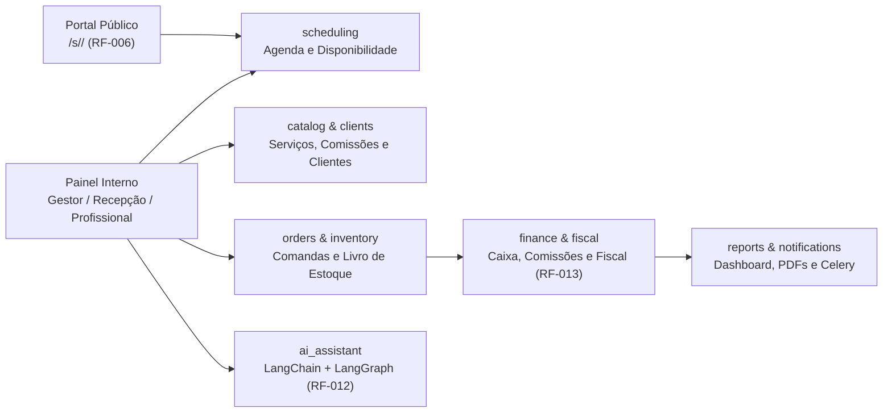

# SPS (Sistema Para Salões) — Documentação Técnica e Operacional

Bem-vindo à documentação viva do **SPS (Sistema Para Salões)**, plataforma SaaS multi-tenant para gestão integrada de salões de beleza e barbearias desenvolvida em **Python `3.13.6`** e **Django `5.2 LTS`**.

---

## 1. Visão Geral da Arquitetura e Domínio

O **SPS** centraliza a operação de salões independentes com isolamento estrito por organização (`Salon` — `DEC-002`), abrangendo desde o autoagendamento público até o fechamento atômico de comandas no caixa, cálculo de comissões, livro razão de estoque, preparação estrutural para notas fiscais (`NFS-e` / `NFC-e` — `DEC-003`), relatórios privados em PDF e assistente gerencial interno de IA (`LangChain` + `LangGraph`).



---

## 2. Mapa de Apps Django do Produto (`sps/`)

| Pacote / App | Requisitos Atendidos | Responsabilidade Principal |
|---|---|---|
| [`core`](01_planejamento/arquitetura_dados_e_seguranca_prd.md) | `RNF-001` a `RNF-006` | Configuração central (`settings.py` com `FileAwareEnv`), roteamento, WSGI/ASGI e instância `Celery`. |
| [`base`](01_planejamento/arquitetura_dados_e_seguranca_prd.md) | `RNF-001`, `RNF-006` | `TimeStampedModel`, `TenantScopedModel`, mixins de autorização por perfil, `/healthz/`, `/readyz/`, `wait_for_db` e `seed_demo_data`. |
| [`salons`](01_planejamento/requisitos_do_projeto.md) | `RF-001`, `DEC-003` | Tenant `Salon` (dados operacionais, prazo de cancelamento público e metadados fiscais de emitente/Salão-Parceiro), `SalonBusinessHours` e `SalonHoliday`. |
| [`accounts`](01_planejamento/requisitos_do_projeto.md) | `RF-002`, `DEC-002` | `AUTH_USER_MODEL` customizado com login por e-mail, papéis (`superadmin_saas`, `gestor`, `recepcionista`, `profissional`) e vínculo fixo `salon`. |
| [`catalog`](01_planejamento/requisitos_do_projeto.md) | `RF-003`, `DEC-003` | `ServiceCategory`, `Service` (com códigos fiscais LC 116, CNAE e ISS), `ProfessionalServiceCommission` e resolução de precedência de comissão. |
| [`clients`](01_planejamento/requisitos_do_projeto.md) | `RF-004`, `DEC-003` | Cadastro de `Client` isolado por salão com normalização de telefone/CPF, dados de tomador fiscal e histórico de atendimentos/comandas. |
| [`scheduling`](01_planejamento/requisitos_do_projeto.md) | `RF-005`, `RF-006` | `ProfessionalSchedule`, `ScheduleBlock`, `Appointment`, `AppointmentItem`, `AvailabilityService`, `SchedulingService` (`select_for_update`) e portal público `/s/<slug>/`. |
| [`inventory`](01_planejamento/requisitos_do_projeto.md) | `RF-008`, `DEC-003` | `Product` (metadados NCM, CEST, CFOP, origem e ICMS), alertas de estoque mínimo e livro razão imutável `StockMovement` com bloqueio de saldo negativo. |
| [`orders`](01_planejamento/requisitos_do_projeto.md) | `RF-007` | `ServiceOrder`, `OrderServiceItem` e `OrderProductItem` com abertura avulsa ou a partir de agendamento. |
| [`finance`](01_planejamento/requisitos_do_projeto.md) | `RF-009`, `RNF-002` | `CashRegisterSession`, `CashTransaction`, `OrderPayment`, `CommissionEntry` e `OrderCheckoutService` (fechamento e estorno atômicos). |
| [`fiscal`](01_planejamento/requisitos_do_projeto.md) | `RF-013`, `DEC-003` | `FiscalDocumentRecord` e contrato desacoplado `FiscalGatewayAdapter` (`StubFiscalGatewayAdapter`) para futura emissão de NFS-e e NFC-e. |
| [`notifications`](01_planejamento/requisitos_do_projeto.md) | `RF-010` | `NotificationLog` e tasks Celery idempotentes para envio de confirmação, cancelamento e lembretes por e-mail. |
| [`reports`](01_planejamento/requisitos_do_projeto.md) | `RF-011`, `RNF-005` | Dashboard Gerencial e exportação privada de relatórios em PDF (`ReportLab` + `PyPDF`) validando tenant e perfil. |
| [`ai_assistant`](01_planejamento/requisitos_do_projeto.md) | `RF-012` | Assistente Gerencial Interno com `LangChain` + `LangGraph` e *tools* somente-leitura protegidas por *closure* no servidor. |

---

## 3. Como Executar Localmente e Carregar Dados de Demonstração (`seed_demo_data`)

### 3.1 Preparação e Execução com Ambiente Virtual (`.venv`)
```powershell
Set-Location "c:\Users\lucas\Desktop\Sistema para barbearia\sps"
# Para desenvolvimento rápido sem containers ativos:
$env:DEBUG="True"
$env:USE_SQLITE_FALLBACK="True"
.\.venv\Scripts\python.exe manage.py migrate
.\.venv\Scripts\python.exe manage.py seed_demo_data
.\.venv\Scripts\python.exe manage.py runserver
```

### 3.1.1 Execução Completa com Infraestrutura Local (`Docker Compose`)
Quando o Docker Desktop estiver ativo, suba os serviços de apoio (`PostgreSQL 16`, `RabbitMQ 3.13` e `Redis 7`) definidos em `docker-compose.yml`:
```powershell
Set-Location "c:\Users\lucas\Desktop\Sistema para barbearia\sps"
docker compose up -d
Copy-Item .env.example .env
.\.venv\Scripts\python.exe manage.py wait_for_db
.\.venv\Scripts\python.exe manage.py migrate
.\.venv\Scripts\python.exe manage.py seed_demo_data
.\.venv\Scripts\python.exe -m mkdocs serve
```

### 3.2 Credenciais Criadas pelo `seed_demo_data` (Apenas Ambiente Local `DEBUG=True`)
Todas as contas sintéticas utilizam a senha de demonstração `SpsDemo@2026!`:

| E-mail de Login | Perfil (`role`) | Salão Vinculado | URL Pública do Salão |
|---|---|---|---|
| `superadmin@sps.local` | `superadmin_saas` | Global (Admin SaaS) | `/admin/` |
| `gestor@alpha.sps.local` | `gestor` | Salão Alpha Studio | `/s/salao-alpha/` |
| `recepcao@alpha.sps.local` | `recepcionista` | Salão Alpha Studio | `/s/salao-alpha/` |
| `ana@alpha.sps.local` | `profissional` | Salão Alpha Studio | `/s/salao-alpha/` |
| `carlos@alpha.sps.local` | `profissional` | Salão Alpha Studio | `/s/salao-alpha/` |
| `gestor@belle.sps.local` | `gestor` | Salão Belle Femme | `/s/salao-belle/` |
| `recepcao@belle.sps.local` | `recepcionista` | Salão Belle Femme | `/s/salao-belle/` |

### 3.3 Execução da Suíte Completa de Testes Automatizados (`DEC-001`)
```powershell
Set-Location "c:\Users\lucas\Desktop\Sistema para barbearia\sps"
$env:USE_SQLITE_FALLBACK="True"
.\.venv\Scripts\python.exe manage.py test -v 2
```

---

## 4. Índice Navegável da Documentação (`sps/docs/`)

### Planejamento e Especificação (`01_planejamento/`)
- [PRD — Documento Central (`v1.0.0`)](01_planejamento/prd_do_projeto.md)
- [Requisitos Funcionais e Não Funcionais (`RF-001` a `RF-013`, `RNF-001` a `RNF-006`)](01_planejamento/requisitos_do_projeto.md)
- [Arquitetura, Modelagem de Dados, Transações e Segurança](01_planejamento/arquitetura_dados_e_seguranca_prd.md)
- [Catálogo Visual e Tokens do Design System](01_planejamento/catalogo_design_system.md)
- [Planejamento das 10 Sprints de Implementação](01_planejamento/sprints_de_implementacao_prd.md)
- [Guia de Deploy no PRD](01_planejamento/guia_deploy_vps_swarm_e_operacao_prd.md)
- [Prompt Inicial Bruto](01_planejamento/prompt_inicial_do_projeto.md) e [Prompt Refinado Aprovado](01_planejamento/prompt_refinado_do_projeto.md)

### Decisões Arquiteturais (`03_decisoes/`)
- [Decisões Arquiteturais Iniciais (`DEC-001`, `DEC-002`, `DEC-003`)](03_decisoes/decisoes_arquiteturais_iniciais.md)

### Execução e Evidências por Sprint (`02_execucao/`)
- [Estado Atual do Projeto e Passagens de Etapa](02_execucao/estado_do_projeto.md)
- [Evidências da Sprint 01](02_execucao/evidencias_da_sprint_001.md) • [Sprint 02](02_execucao/evidencias_da_sprint_002.md) • [Sprint 03](02_execucao/evidencias_da_sprint_003.md) • [Sprint 04](02_execucao/evidencias_da_sprint_004.md) • [Sprint 05](02_execucao/evidencias_da_sprint_005.md)
- [Evidências da Sprint 06](02_execucao/evidencias_da_sprint_006.md) • [Sprint 07](02_execucao/evidencias_da_sprint_007.md) • [Sprint 08](02_execucao/evidencias_da_sprint_008.md) • [Sprint 09](02_execucao/evidencias_da_sprint_009.md) • [Sprint 10](02_execucao/evidencias_da_sprint_010.md)

### Operação e Produção (`04_operacao/`)
- [Runbook de Implantação, Backup e Restauração em VPS Ubuntu (Docker Swarm)](04_operacao/runbook_de_implantacao.md)

---

## 5. Mapa Geral de Rotas e Endpoints do Sistema (`sps/core/urls.py`)

| Prefixo de Rota | Namespace | Escopo / Autenticação | Descrição |
|---|---|---|---|
| `/healthz/` e `/readyz/` | `base` | Público (isentos de SSL redirect) | Probes de *liveness* e *readiness* (verifica `SELECT 1` no PostgreSQL). |
| `/conta/entrar/`, `/conta/sair/` | `accounts` | Público / Autenticado | Autenticação nativa por e-mail e encerramento de sessão. |
| `/conta/equipe/` | `accounts` | `gestor` | Gestão de membros da equipe do salão (`gestor`, `recepcionista`, `profissional`). |
| `/salao/` | `salons` | `gestor` (escrita) / Equipe (leitura) | Configurações operacionais/fiscais, expediente semanal e feriados do salão. |
| `/catalogo/` | `catalog` | `gestor` (escrita) / Equipe (leitura) | Categorias, serviços (com LC 116/CNAE/ISS) e regras específicas de comissão. |
| `/clientes/` | `clients` | `gestor`, `recepcionista` | Cadastro de clientes, dados fiscais de tomador e histórico de atendimentos/comandas. |
| `/agenda/` | `scheduling` | `gestor`, `recepcionista`, `profissional` | Agenda Inteligente (visão diária/semanal, múltiplos serviços, remarcação, status, escalas e bloqueios). |
| `/s/<slug_salao>/` | `public_booking` | Público (`cliente_final`) | Autoagendamento público com cálculo de horários reais e comprovante/cancelamento por `public_token`. |
| `/estoque/` | `inventory` | `gestor` (escrita) / `recepcionista` (leitura) | Cadastro de produtos (NCM/CEST/CFOP), alertas de estoque crítico e livro razão `StockMovement`. |
| `/comandas/` | `orders` | `gestor`, `recepcionista` | Abertura e operação de comandas mistas (serviços por múltiplos profissionais + produtos). |
| `/caixa/` | `finance` | `gestor`, `recepcionista`, `profissional` (extrato próprio) | Sessão de caixa diário, fechamento/pagamento atômico, estorno (`gestor`) e extrato/baixa de comissões. |
| `/relatorios/` | `reports` | `gestor`, `recepcionista`, `profissional` (PDF próprio) | Dashboard Gerencial e exportação privada de relatórios em PDF (`ReportLab` + `PyPDF`). |
| `/assistente/` | `ai_assistant` | `gestor`, `recepcionista` | Chat do Assistente Gerencial Interno de IA (`LangChain` + `LangGraph`). |
| `/admin/` e `/admin/dj-celery-panel/` | `admin` | `superadmin_saas` / `is_staff` | Administração global da plataforma e monitoramento de filas Celery. |

---

## 6. Resumo da Matriz de Autorização por Perfil (`RNF-001`)

| Capacidade / Módulo | `superadmin_saas` | `gestor` | `recepcionista` | `profissional` | `cliente_final` |
|---|---|---|---|---|---|
| Django Admin Global (`/admin/`) | Sim | Não | Não | Não | Não |
| Dados Fiscais, Equipe e Catálogo do Salão | Via Admin | Leitura/Escrita | Somente Leitura | Somente Leitura | Não |
| Clientes, Comandas e Caixa Diário | Via Admin | Leitura/Escrita | Leitura/Escrita | Bloqueado (`403`) | Não |
| Estorno de Comanda Paga e Baixa de Comissões | Via Admin | Exclusivo | Bloqueado (`403`) | Bloqueado (`403`) | Não |
| Extrato e PDF de Comissões | Via Admin | Todos do salão | Bloqueado (`403`) | Apenas próprio | Não |
| Assistente Gerencial de IA (`/assistente/`) | Via Admin | Completo (+ Finanças) | Operacional | Bloqueado (`403`) | Não |
| Portal Público (`/s/<slug>/`) | Sim | Sim | Sim | Sim | Sim |

